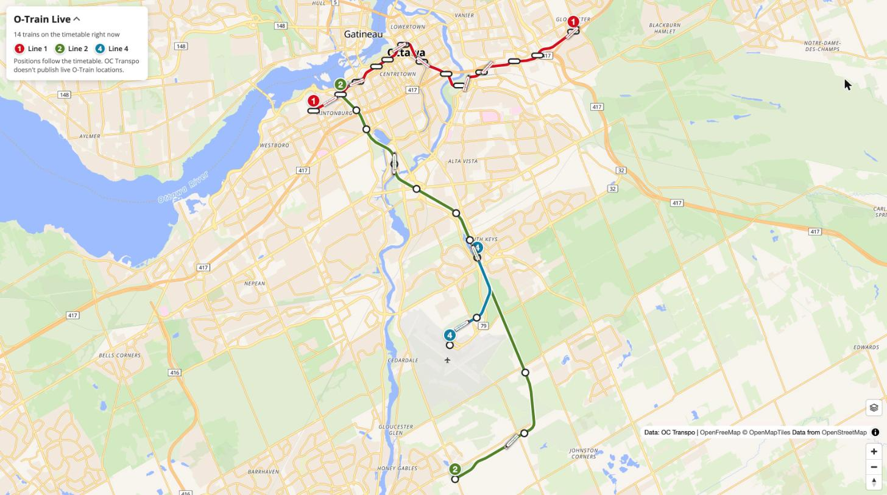
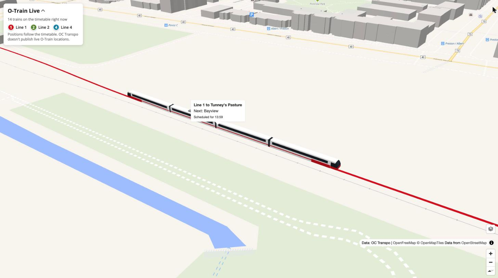
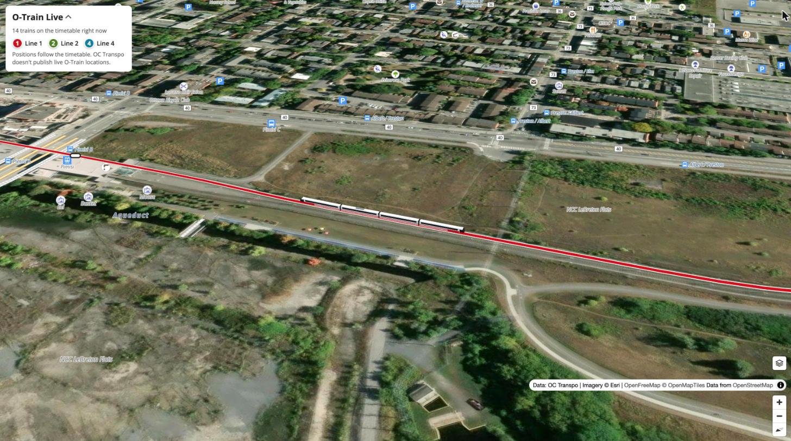
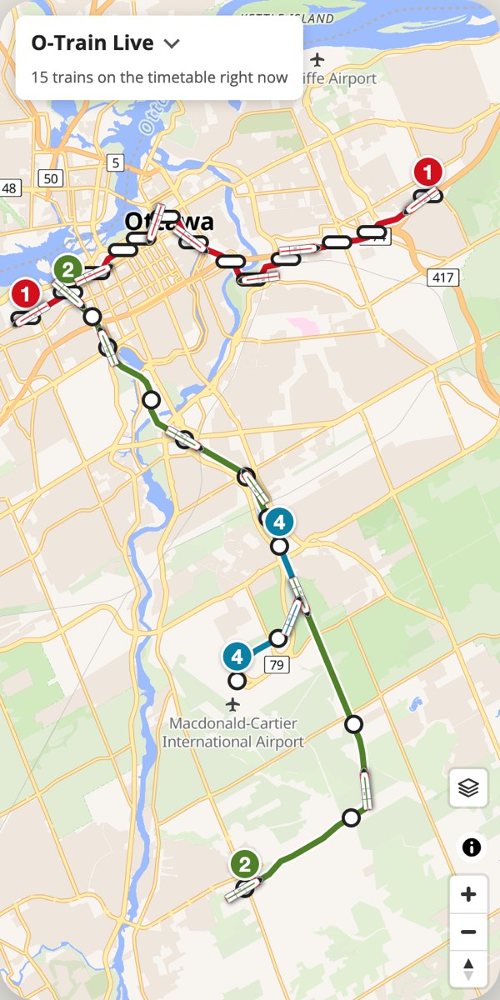

# O-Train Live

Animated map of OC Transpo O-Train Lines 1, 2 and 4 at **[otrain.matranc.com](https://otrain.matranc.com)**. Static site on GitHub Pages plus a tiny Cloudflare Worker.

| 3D view (layers button → 3D view) | Satellite |
|---|---|
|  |  |

- **Trains** follow the published timetable (`schedule.json`, built from OC Transpo's static GTFS). OC Transpo's GTFS-RT feeds carry buses only, with no O-Train positions.
- **Live disruptions** come through the Worker: R1/R2/R4 replacement buses in the GTFS-RT vehicle feed grey out the section they cover, and O-Train items from the service-updates RSS show as alerts. The Worker holds the API key and adds CORS, since the feed only allows OC Transpo's own portal.

## Setup
1. Get a key at https://nextrip-public-api.developer.azure-api.net/ (subscribe to GTFS-RT).
2. Cloudflare dashboard → Workers → Create → name it `otrain-feed`, paste `worker.js`, deploy.
   Settings → Variables → add secret `OCT_KEY` = your key.
3. Put the Worker URL in `FEED` in `index.html`.
4. DNS (Porkbun): `CNAME otrain → matranc.github.io`. Pages deploys from `main` (root).
5. `.github/workflows/timetable.yml` rebuilds the timetable weekly; run it manually after an OC Transpo service change.

## Dev
- `python3 -m http.server` then open `/?feed=<url>` to point at any feed (e.g. a local mock JSON).
- `node test_worker.mjs` checks the protobuf decoder.
- Line shapes/stations: download https://oct-gtfs-emasagcnfmcgeham.z01.azurefd.net/public-access/GTFSExport.zip, unzip, `python3 build_lines.py <dir>` → `lines.json` (station positions come from OpenStreetMap via Overpass, snapped onto the line). Rerun when OC Transpo changes service (e.g. Line 1 extensions open).
- Yards: `python3 build_depots.py` → `depots.json`, the OSM yard track from the main line into Belfast (Line 1) and Walkley (Lines 2/4). After its last trip a train runs empty there. Rerun if the lines or yards change.
